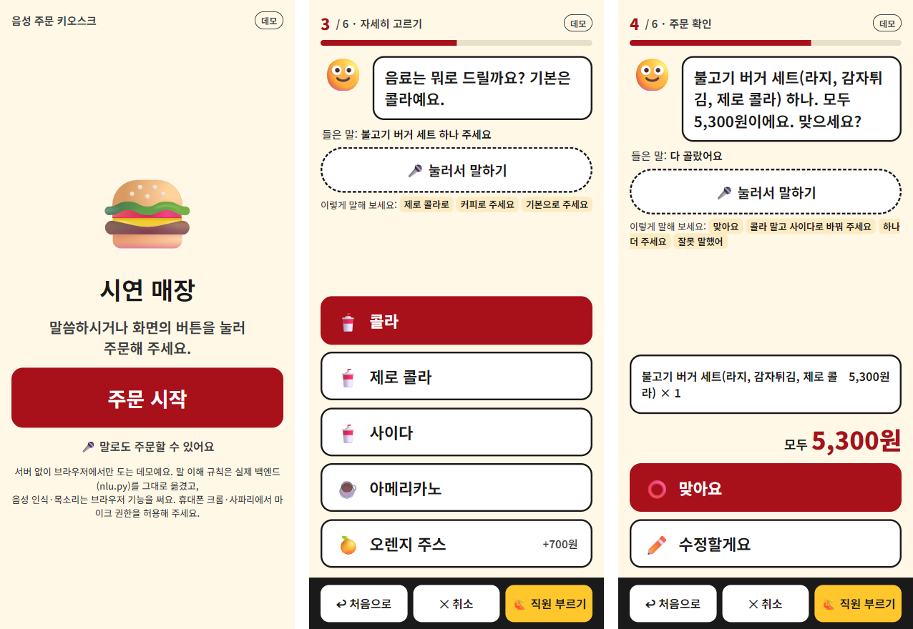
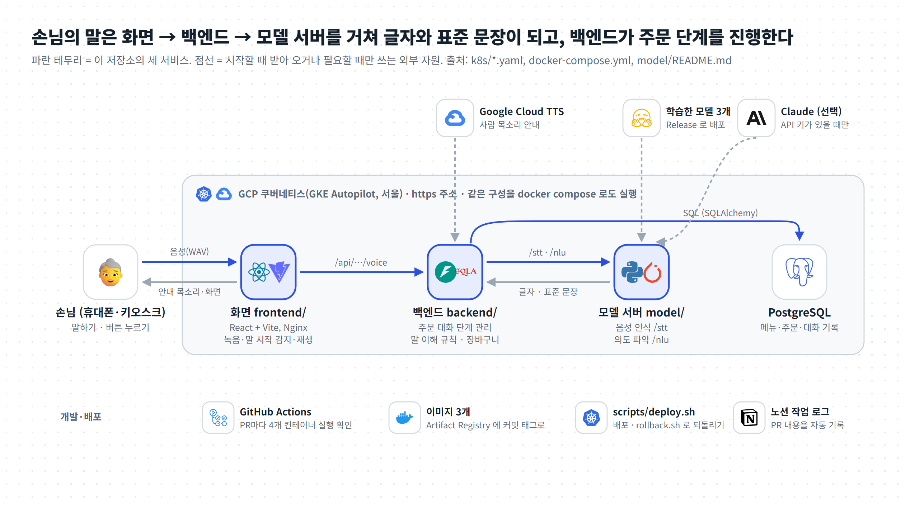
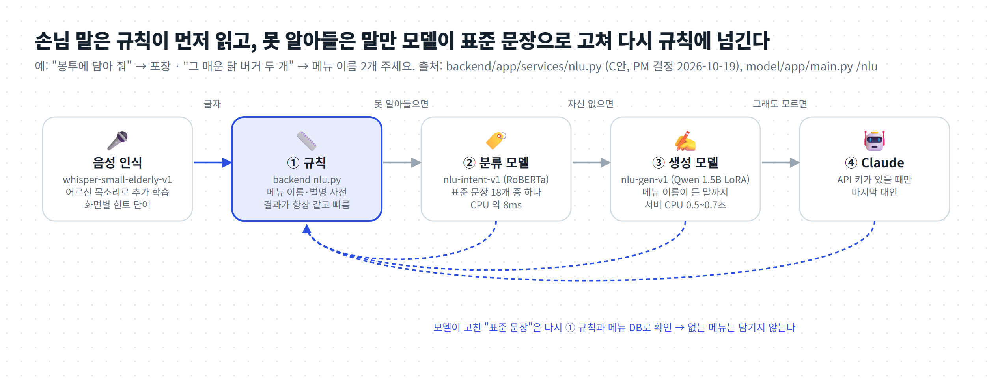
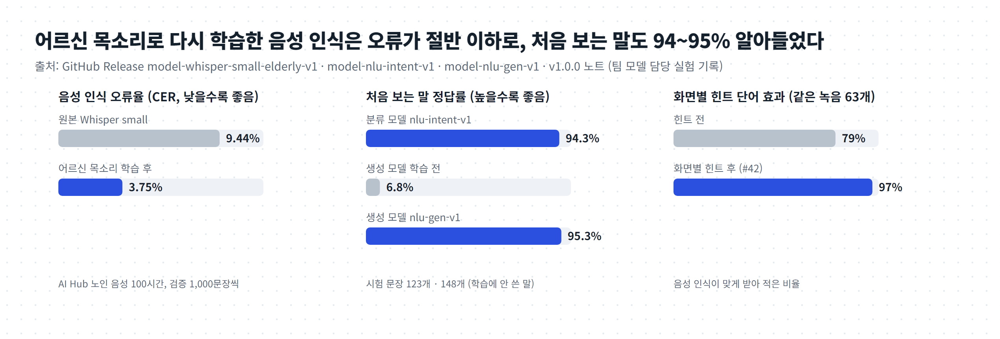
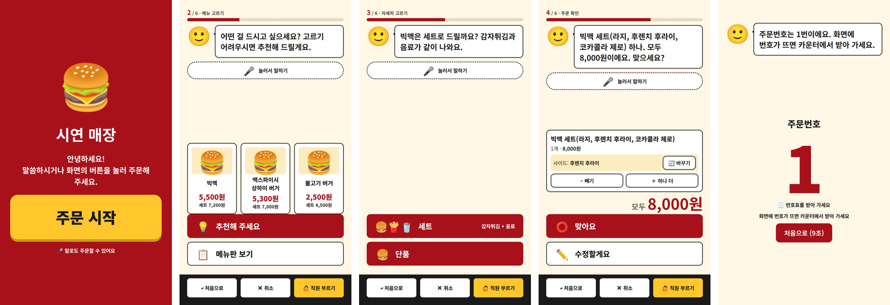

# 어르신을 위한 음성 주문 키오스크 ― 말로 주문하는 패스트푸드 키오스크

> 디지털 기기가 낯선 어르신도 **점원에게 말하듯** 주문할 수 있는 키오스크입니다. 버튼으로도 똑같이 주문할 수 있습니다.
> 노인 음성으로 다시 학습한 음성 인식(오류율 9.44% → **3.75%**)과, 규칙 + 의도 파악 모델 2개(처음 보는 말 **94.3% · 95.3%**)로 손님 말을 알아듣습니다.
> 기간: 2026.10.16 – (진행 중) · 형태: 팀 프로젝트 5명 · 내 역할: PM(팀장), 음성 대화·의도 파악·배포 개선 (PR 36개 중 23개)

| 바로 보기 | 주소 |
|---|---|
| **브라우저 데모** (서버 없이, 말로 주문해 보기) | **https://sjzzang776.github.io/fundamental1-project/demo/** |
| 실제 서비스 (GKE 배포) | https://8-232-203-94.sslip.io/ ― **휴대폰에서 열어야 잘 동작합니다** (세로 화면 기준 설계, 마이크 권한 허용) |
| 그림으로 먼저 보기 | [00_ELI5_저장소설명.pdf](00_ELI5_저장소설명.pdf) (4쪽, 처음 보는 개발자용) |
| 코드 구조 대시보드 | [온라인으로 보기](https://sjzzang776.github.io/fundamental1-project/dashboard/) · [구조 분석 문서](docs/01_UnderstandAnything_분석.md) · [내 컴퓨터에서 보는 법](#코드-구조-대시보드-understand-anything) |
| 노션 (팀 문서) | [처음 노션](https://app.notion.com/p/likelion/A-3f144860a4f48025bb02f67f3f518c67) → 무료 블록 수 초과로 [새 노션](https://app.notion.com/p/Notion-3fe68523797880cc8097f968a9ccd5c9)으로 옮김 (이후 기록은 새 노션) |



---

## 한눈에 보기

| 항목 | 내용 |
|---|---|
| 문제 | 터치 키오스크는 글씨가 작고 단계가 많아 어르신이 주문을 포기하거나 뒤에 줄 선 사람 때문에 서두르게 된다 |
| 해결 | 말로 주문 전체(식사 장소 → 메뉴 → 세트·음료·사이즈 → 주문 확인 → 쿠폰 → 결제)를 진행하고, 버튼 하나하나도 "그 글자를 말한 것"과 똑같이 처리 |
| 말 알아듣기 | ① 규칙(메뉴 이름·별명·말버릇) → 못 알아들으면 ② 분류 모델 → ③ 생성 모델 → ④ Claude(키가 있을 때). 모델이 고친 문장도 다시 규칙과 메뉴 DB로 확인해 없는 메뉴는 담기지 않음 |
| 어르신 배려 | 말하면 바로 듣기(안내 중 끼어들기), 사람 목소리 안내, "천천히/크게 말해 줘", "잘못 말했어", "다 해서 얼마예요", 무응답 15초 → "도움이 필요하세요?", 직원 호출, 한 화면 버튼 최대 4개 |
| 결과 | 음성 인식 오류율 9.44% → 3.75%, 처음 보는 말 94.3%(분류)·95.3%(생성), 화면별 힌트로 같은 녹음 63개 인식 79% → 97%, 백엔드 시험 109개 통과, GKE 9차 배포 |
| 기술 | React · Vite · Nginx / FastAPI · SQLAlchemy · PostgreSQL / Whisper small(faster-whisper) · RoBERTa 분류 · Qwen2.5-1.5B LoRA(GGUF) / Docker Compose · GKE Autopilot · GitHub Actions |
| 상태 | 시연 운영 중 (결제는 모의 결제), 계속 개선 중 |

## 왜 만들었나 (문제 정의)

- 패스트푸드 키오스크는 "세트? 사이즈? 음료 10종? 쿠폰 바코드?"처럼 한 번의 주문에 여러 화면을 거친다. 작은 글씨와 많은 버튼은 어르신에게 특히 어렵다.
- 점원에게는 "불고기 버거 세트, 콜라는 제로로"처럼 한 문장으로 말한다. 그래서 **말 한 문장에 메뉴·세트·옵션·수량이 섞여 있어도** 알아듣고, 빠진 것만 되묻는 키오스크를 목표로 했다.
- 어르신 목소리는 일반 음성 인식 모델이 잘 못 알아듣는다(원본 Whisper small 오류율 9.44%, 키오스크 문장은 12.26%). 그래서 노인 음성 데이터로 다시 학습했다.

## 어떻게 동작하나



1. **듣기 (frontend/)** ― 주문 중에는 마이크를 열어 두고 소리 크기만 본다. 주변 소음보다 4배 이상 큰 목소리가 0.3초 이어지면 녹음을 시작하고(직전 1초 포함), 1초 조용하면 16kHz WAV로 보낸다 (`hooks/useVoice.js`, `lib/vad.js`).
2. **받아쓰기 (model/ `/stt`)** ― 노인 음성으로 다시 학습한 Whisper small이 글자로 바꾼다. 지금 화면에서 할 법한 말(예: 식사 장소 화면이면 "포장", "먹고 갈게요")을 힌트로 함께 준다.
3. **뜻 파악·다음 단계 (backend/)** ― `services/nlu.py`가 의도와 메뉴를 찾고, `services/dialog.py`가 주문 단계를 진행하며 안내 문장과 버튼을 만든다.
4. **말하기·그리기 (frontend/)** ― 응답의 `step`·`question` 값으로 그릴 화면을 고르고(`lib/screen.js`), 안내 문장을 사람 목소리(Google Cloud TTS, 실패하면 브라우저 목소리)로 읽는다.



## 구성 (폴더 지도)

```
frontend/   React 손님 화면 · 픽업 호출 · 주방 화면, Nginx
backend/    FastAPI: 세션·대화·메뉴·주문·주방 API, 말 이해 규칙, 장바구니·쿠폰·모의 결제, 안내 음성 합성
model/      FastAPI 모델 서버: /stt(음성 인식), /nlu(의도 파악), 학습 노트북·데이터 준비 스크립트
k8s/        GKE 배포 매니페스트, 배포 기록(DEPLOY_LOG.md)
scripts/    배포·되돌리기 스크립트
docs/       기획 결정, AI 작업 루틴, 이 정리 문서들(구조 분석·ELI5·데모·대시보드·그림)
.github/    CI(4개 컨테이너 실행 확인), PR 내용을 노션 작업 로그로 옮기는 워크플로
```

| 파일 | 하는 일 | 핵심 기술 |
|---|---|---|
| `backend/app/services/dialog.py` | 주문 대화 상태 머신: 단계별 안내·버튼, 수정·되돌리기, 쿠폰·확정 | 단계(step)·기다리는 대답(awaiting) 상태, JSON 칼럼 |
| `backend/app/services/nlu.py` | 손님 말 → 의도·메뉴·옵션·수량·식사 장소. 규칙이 못 알아들으면 모델 서버 `/nlu` | 긴 이름부터 찾는 사전 매칭, 60초 서킷 브레이커 |
| `backend/app/routers/sessions.py` | `/api/sessions` 시작·대화·음성·쿠폰·확정 | FastAPI, 비동기 httpx로 `/stt` 호출 |
| `frontend/src/hooks/useVoice.js` | 손 안 대고 말하기: 말 시작 감지, 녹음, 안내 재생, 끼어들기 | Web Audio, VAD, WAV 인코딩 |
| `frontend/src/screens/Kiosk.jsx` | 손님 화면 전체 틀(진행 막대·말풍선·마이크·본문·하단 버튼) | React, Context로 음성 화면 조작 |
| `model/app/stt.py` | 음성 → 글자, 화면별 힌트 단어 | faster-whisper int8 |
| `model/app/nlu_intent.py`, `nlu_gen.py` | 못 알아들은 말 → 표준 문장 | ONNX RoBERTa, llama.cpp GGUF Qwen |
| `k8s/`, `scripts/deploy.sh` | 이미지 빌드·배포·기록, `rollback.sh`로 되돌리기 | GKE Autopilot, kustomize |

더 자세한 구조와 읽는 순서: [docs/01_UnderstandAnything_분석.md](docs/01_UnderstandAnything_분석.md)

## 핵심 설계와 이유

| 무엇을 | 왜 그렇게 | 대안 |
|---|---|---|
| 규칙 먼저, 모델은 못 알아들은 말만 (C안, 2026-10-19 PM 결정) | 규칙은 빠르고 결과가 늘 같아 시험하기 쉽다. 모델은 처음 듣는 말을 돕는다. 모델이 고친 문장도 규칙·메뉴 DB를 다시 거쳐 없는 메뉴가 담기지 않는다 | 처음부터 LLM에 맡기기: 느리고 비싸며 결과가 매번 달라짐 |
| 버튼 = 그 글자를 말한 것 | 음성과 터치가 같은 길(`/chat`)을 타서 대화 규칙이 한곳에만 있다 | 버튼마다 별도 API |
| 화면은 서버 응답(`question`)으로 고른다 | 같은 단계 안에서도 질문(세트? 음료? 사이즈?)마다 화면이 달라야 한다 | 프론트가 글자를 보고 추측 |
| 세트 사이드는 묻지 않고 기본값 | 질문 수를 줄여 어르신이 덜 지치게 (기획 결정 2026-10-19) | 모두 묻기 |
| 한 화면 버튼 최대 4개, 넘치면 쪽 나누기 | 메뉴를 줄이지 않고 "한 화면 3~4개" 규칙 유지, 말로는 언제든 전부 고를 수 있음 | 작은 버튼 여러 개 |

**어려웠던 점과 해결**

| 문제 | 원인 | 해결 (PR) |
|---|---|---|
| "포장해"가 "보장해"로 인식 | 말 시작 감지가 늦어 첫소리 0.04~0.08초가 잘림 | 시작 감지 완화 + 1초 앞부터 보내기 (#38) |
| 사람 목소리 안내 중에 끼어들면 안 들림 | 마이크 에코 제거가 안내 목소리와 함께 손님 목소리도 깎음 | 에코 제거 끄기 (#37) |
| "포장해 줘"가 메뉴 이름 비슷한 말로 끌려감 | 어느 화면이든 메뉴 이름만 힌트로 줌 | 화면별 힌트 단어: 같은 녹음 63개 79% → 97% (#42) |
| 말소리 없는 녹음에서 메뉴 이름 목록이 글자로 나옴 | 힌트 단어를 그대로 읽어 버림 | 빈 녹음 거르기 (#39) |
| 생성 모델 응답 1.7초 | 스레드 수가 CPU 요청보다 많아 쿠버네티스 CPU 제한에 걸림 | 스레드 8 → 6: 0.5~0.7초 (#40) |
| 새 모델 Pod가 Pending | GCP 전체 CPU 할당량 32 초과 | 이전 Pod를 먼저 내리고 교체하도록 배포 방식 수정 (#34) |
| AI Hub 데이터를 Colab에서 못 받음 | AI Hub가 해외 IP 차단 | 내 컴퓨터에서 받아 줄인 뒤 Drive로 (#7) |

## AI를 어떻게 썼나

- **팀 작업 방식:** 팀원 대부분이 비전공자라, 저장소에 AI 작업 루틴을 넣었다(`AGENTS.md`, `docs/ai/catch-up.md`·`wrap-up.md`). 작업 시작 시 "무엇이 바뀌었나"를 정리하고, 마무리 때 브랜치·PR·CI 확인·병합·노션 작업 로그까지 같은 절차로 진행한다. PR 본문은 GitHub Actions가 노션 작업 로그로 자동으로 옮긴다.
- **제품 안의 AI:** 의도 파악 모델 2개를 직접 학습했다. 데이터는 `make_nlu_data.py`가 말투를 섞어 만들고, 시험 문장(`nlu_testset.csv` 123개, `nlu_gen_testset.csv` 148개)은 사람이 따로 써서 학습에 쓰지 않은 말로 평가했다. Claude는 키가 있을 때만 쓰는 마지막 대안이다.
- **검증:** 모델 답은 그대로 쓰지 않고 규칙·메뉴 DB로 다시 확인한다. 기준값(0.95)을 두어 확신이 낮으면 "모름"으로 답하게 했다(맞음 88.6% · 오답 1.6% · 모름 9.8%). 오답이 "다시 말씀해 주세요"보다 나쁘기 때문이다.

## 결과



| 모델 | 하는 일 | 성능 (GitHub Release 기록) |
|---|---|---|
| `whisper-small-elderly-v1` | 음성 → 글자 (AI Hub 노인 음성 100시간으로 추가 학습) | 오류율(CER) 9.44% → **3.75%** (키오스크 문장 12.26% → 3.13%), CPU 4코어 문장당 약 1.8초 |
| `nlu-intent-v1` (klue/roberta-small) | 손님 말 → 표준 문장 18개 중 하나 | 처음 보는 말 123개 **94.3%**, CPU 문장당 약 8ms |
| `nlu-gen-v1` (Qwen2.5-1.5B + LoRA, GGUF Q4) | 메뉴 이름이 든 말까지 표준 문장으로 | 처음 보는 말 148개: 학습 전 6.8% → **95.3%**, 배포 서버 0.5~0.7초 |

**실제 서비스 화면** (팀 프론트엔드 작업 캡처, `frontend/docs/screenshots/`)



## 브라우저 데모

**https://sjzzang776.github.io/fundamental1-project/demo/** ― 서버 없이 브라우저에서만 돕니다.

- **말로 주문:** 🎤 버튼을 누르고 말하면 됩니다. 브라우저 내장 음성 인식(Web Speech API)을 써서 **안드로이드·PC 크롬, 엣지, iPhone 사파리**에서 됩니다(마이크 권한 허용). 지원하지 않는 브라우저(파이어폭스 등)에서는 글로 입력하는 칸이 나옵니다. 화면의 "이렇게 말해 보세요" 예시를 눌러도 됩니다.
- **같은 규칙:** 말 이해 규칙은 `backend/app/services/nlu.py`를 그대로 JavaScript로 옮겼고, 58개 문장에서 파이썬 원본과 결과가 모두 같은지 대조했습니다([`docs/demo/verify/`](docs/demo/verify/)). 대화 흐름은 `dialog.py`를 줄여 옮겼습니다(쿠폰 단계 없음).
- **실제 서비스와 다른 점:** 음성 인식은 학습한 Whisper가 아니라 브라우저 기능이고, 의도 파악 모델(②③④)은 없으며, 메뉴는 상표 없는 일반 이름입니다.

## 설치와 실행

필요한 것: Docker Desktop, (모델 파일을 받으려면) GitHub CLI 로그인

```bash
cp .env.example .env                                                        # 처음 한 번
bash model/scripts/fetch_model.sh && bash model/scripts/fetch_nlu_model.sh  # 모델 파일 약 1.3GB (GitHub Release)
docker compose up --build                                                   # → http://localhost:3000
```

| 하고 싶은 일 | 명령 |
|---|---|
| 개발 모드(저장하면 바로 반영) | `docker compose -f docker-compose.yml -f docker-compose.dev.yml up --build frontend-dev` → http://localhost:5173 |
| 백엔드 시험만 (DB·모델 없이) | `cd backend && pip install -r requirements-dev.txt && pytest -q` (109개, 약 15초) |
| 배포 | `bash scripts/deploy.sh` (자세한 것은 [k8s/README.md](k8s/README.md)), 되돌리기 `bash scripts/rollback.sh <태그>` |

- `ANTHROPIC_API_KEY`(Claude 대안), `TTS_API_KEY`(사람 목소리)는 비워 둬도 됩니다. 각각 규칙·모델만, 브라우저 목소리로 동작합니다.
- 자주 막히는 곳: 모델 파일 없이 빌드하면 원본 Whisper를 시작할 때 내려받아 느립니다. 휴대폰으로 배포 주소를 열 때는 https여야 마이크가 켜집니다.

## 팀

| 이름 | 파트 | 담당 폴더 |
|---|---|---|
| 최세진 | PM (팀장) · 음성 대화·의도 파악 모델·배포 개선 | `docs/`, 공통 |
| 윤지연 | 기획 | `docs/plan/` |
| 길버트 킴 | 백엔드 · 배포 | `backend/`, `k8s/`, `docker-compose*.yml` |
| 정현진 | 프론트엔드 | `frontend/` |
| 황혜림 | 모델 (음성 인식 학습) | `model/` |

작업 규칙: 자기 파트 폴더만 고치고, `main`에 직접 올리지 않고 브랜치 + PR(`[파트] 한 일`), CI(4개 컨테이너 실행 확인)를 통과하면 병합합니다. 자세한 것은 [AGENTS.md](AGENTS.md).

## 한계와 다음 계획

- 결제는 모의 결제입니다(실제 카드 결제 없음). 주방 화면과 시연용 쿠폰 초기화에 잠금이 없습니다.
- 대화 상태 머신(`dialog.py`, 929줄)이 커서 단계별로 나누는 정리가 필요합니다.
- 실제 어르신 사용자 시험은 아직입니다. 화면별 힌트 효과(79% → 97%)는 팀이 녹음한 63개 문장 기준입니다.
- 음성 인식 모델은 AI Hub 데이터로 학습했습니다. 사용할 때 AI Hub 데이터 사용을 밝혀야 합니다.

## 사용한 기술

| 분류 | 도구 |
|---|---|
| 화면 | React 18, Vite, Nginx, Web Audio API(VAD·WAV), Playwright(e2e) |
| 백엔드 | FastAPI, SQLAlchemy 2.0, PostgreSQL 16, httpx, pytest, Google Cloud Text-to-Speech |
| 모델 | faster-whisper(Whisper small, int8), Transformers, ONNX Runtime(klue/roberta-small), llama.cpp(Qwen2.5-1.5B LoRA, GGUF Q4), Anthropic Claude(선택) |
| 학습 데이터 | AI Hub 명령어 음성(노인남여) 키오스크 60시간 + 자유대화 음성(노인남여) AI스피커 40시간 |
| 배포·협업 | Docker Compose, GKE Autopilot, Artifact Registry, kustomize, GitHub Actions, GitHub Release, Notion |

## 코드 구조 대시보드 (Understand-Anything)

[Understand-Anything](https://github.com/Egonex-AI/Understand-Anything)으로 만든 지식 그래프(파일·함수 366개, 관계 800개, 계층 10개, 읽는 순서 12단계)를 대시보드로 볼 수 있습니다.

- 온라인: **https://sjzzang776.github.io/fundamental1-project/dashboard/**
- 정리 문서: [docs/01_UnderstandAnything_분석.md](docs/01_UnderstandAnything_분석.md)

### 내 컴퓨터에서 보기

```bash
python -m http.server 8000 -d docs/dashboard
# 브라우저에서 http://localhost:8000 을 연다 (끝낼 때는 터미널에서 Ctrl+C)
```
Claude Code에서 플러그인을 쓰는 경우:
```
/plugin install understand-anything
/understand-dashboard        # 저장소 폴더에서 실행하면 .ua/knowledge-graph.json 을 읽어 대시보드를 띄움
/understand                  # 코드를 바꾼 뒤 그래프를 다시 만들 때
```

## 함께 보면 좋은 문서

- [00_ELI5_저장소설명.pdf](00_ELI5_저장소설명.pdf) ― 처음 보는 개발자를 위한 그림 설명 (원본 HTML: [docs/02_ELI5_저장소설명.html](docs/02_ELI5_저장소설명.html))
- [docs/01_UnderstandAnything_분석.md](docs/01_UnderstandAnything_분석.md) ― 구조 분석 (계층, 읽는 순서, PR #44 영향 범위)
- [docs/plan/decisions.md](docs/plan/decisions.md) ― 기획 결정 기록 · [k8s/README.md](k8s/README.md) ― 배포 · [model/README.md](model/README.md) ― 모델
- [docs/figures/make_figures.py](docs/figures/make_figures.py) ― README 그림을 만드는 코드 (로고: Simple Icons, CC0)

<sub>README의 그림은 모두 이 저장소의 코드·배포 설정·Release 기록으로 새로 그린 것입니다. 팀의 원래 README는 [docs/original_README.md](docs/original_README.md)에 있습니다.</sub>
