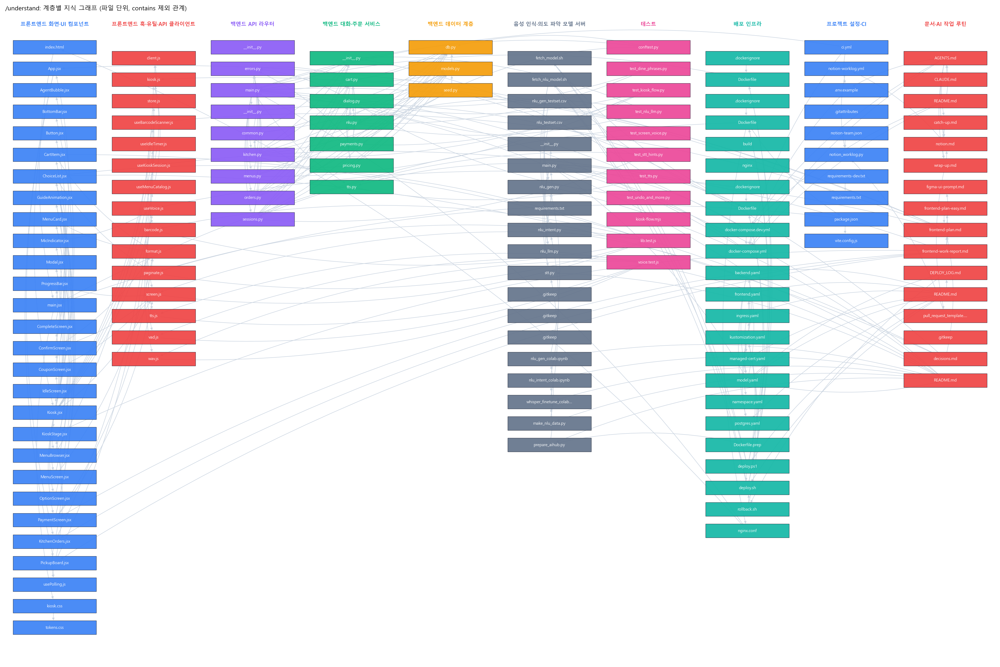
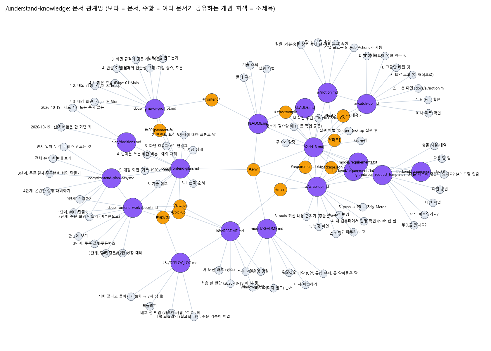
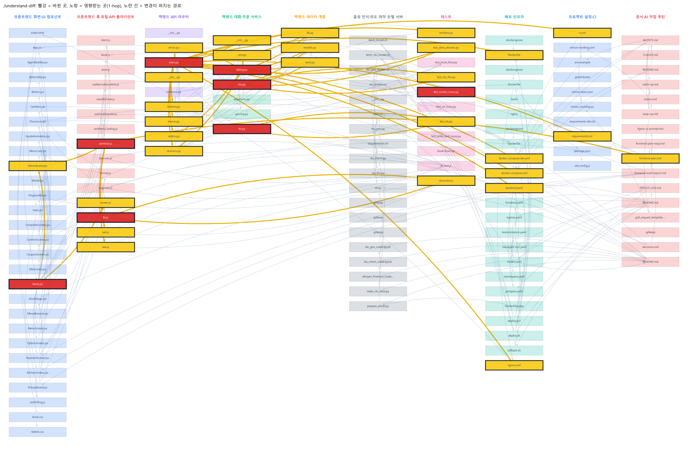

# 음성 주문 키오스크 구조 분석 (Understand-Anything)

> 이 문서는 Understand-Anything 플러그인(v2.9.7)이 만든 지식 그래프(`.ua/knowledge-graph.json`)를 사람이 읽기 쉽게 정리한 것입니다.
> 그래프를 직접 돌려 보려면 [코드 구조 대시보드(온라인)](https://sjzzang776.github.io/fundamental1-project/dashboard/)를 여세요.

## 0. 어떻게 실행했나

| 항목 | 내용 |
|---|---|
| 대상 | `main` 브랜치 `a8cf518` (2026-10-20, 9차 배포 기록까지) |
| 범위 | 파일 139개, 11,648줄. 제외: 화면 캡처(`frontend/docs/screenshots/`), `package-lock.json`, `.claude/`, 이번 정리로 추가한 `docs/` 산출물 (`.ua/.understandignore`) |
| 방법 | 플러그인 `/understand --language ko` (방법 A). 스캔·import 해석은 결정적 스크립트, 파일 요약은 분석 에이전트 7개가 14개 묶음을 나눠 읽음 → 병합 → 검토 → 계층 → 둘러보기 → 검증 |
| 결과 | 노드 366개, 관계 800개, 계층 10개, 둘러보기 12단계. 검증 문제 0건(관계 없는 파일 7개는 `.gitkeep`·`__init__.py` 같은 빈 파일) |
| 명령 2~7 | `project-summary` 스킬의 `ua_commands.py`가 같은 그래프를 읽어 실행 → [`docs/ua/ua_results.json`](ua/ua_results.json), 그림 `docs/img/ua_*.png` |
| 다시 실행 | 코드를 바꾼 뒤 저장소에서 `/understand` (증분 업데이트, `fingerprints.json` 기준) |

## 1. /understand ― 전체 구조

| 수치 | 값 |
|---|---|
| 파일 노드 | 141 (코드 97, 서비스 정의 19, 문서 18, 설정 3, CI 2, 테이블 2) |
| 함수·클래스 | 함수 197, 클래스 28 |
| 관계 | 포함 237 · export 182 · import 146 · 호출 89 · 문서가 설명 38 · 배포 18 · 테스트 17 등 |

| 계층 | 파일 수 | 무엇이 들어 있나 |
|---|---|---|
| 프론트엔드 화면·UI 컴포넌트 | 28 | 손님 화면 흐름(대기 → 메뉴 → 옵션 → 확인 → 결제 → 완료), 주방·픽업 화면, 공용 부품, 디자인 토큰 |
| 프론트엔드 훅·유틸·API 클라이언트 | 15 | 녹음(말 시작 감지·WAV), 안내 음성, 바코드, 세션, 메뉴 목록, 백엔드 호출 |
| 백엔드 API 라우터 | 9 | `/api/sessions`(대화·음성), 메뉴, 주문, 주방 |
| 백엔드 대화·주문 서비스 | 7 | 대화 단계(`dialog.py`), 말 이해 규칙(`nlu.py`), 장바구니, 가격·쿠폰, 결제(모의), 안내 음성 합성 |
| 백엔드 데이터 계층 | 3 | DB 연결, 테이블 15개(`models.py`), 기본 메뉴·쿠폰(`seed.py`) |
| 음성 인식·의도 파악 모델 서버 | 19 | `/stt`, `/nlu`, 학습 노트북 3개, 데이터 준비 스크립트, 시험 문장 |
| 테스트 | 11 | 백엔드 pytest 7개 파일(109개 시험, 이번 정리에서 실행해 모두 통과), 프론트 단위 시험 2개, 화면 흐름 e2e |
| 배포 인프라 | 23 | Dockerfile, docker-compose, k8s 매니페스트, 배포·되돌리기 스크립트, 배포 기록 |
| 프로젝트 설정·CI | 10 | `.env.example`, 의존성, Vite 설정, GitHub Actions(실행 확인·노션 작업 로그) |
| 문서·AI 작업 루틴 | 16 | 팀 규칙(`AGENTS.md`), catch-up·wrap-up 절차, 기획 결정, 프론트 계획서, 모델 안내 |

**도메인 흐름(손님 말 한 번):** 손님이 말함 → `useVoice.js`가 말 시작·끝을 감지해 16kHz WAV로 녹음 → `POST /api/sessions/{id}/voice` → 모델 서버 `/stt`(화면별 힌트 단어 포함)로 글자 → `dialog.handle()`이 `nlu.parse()`로 의도·메뉴를 찾음(규칙이 못 알아들으면 `/nlu`) → 장바구니·단계 갱신, 안내 문장·버튼 생성 → 화면이 `screen.js`로 그릴 화면을 고르고 `tts.js`로 읽어 줌.

**프로젝트를 관통하는 설계 개념**
- **화면은 서버가 정한다:** 프론트는 응답의 `step`·`question` 값만 보고 화면을 고른다. 대화 규칙이 한곳(`dialog.py`)에만 있다.
- **버튼 = 말:** 버튼을 누르면 그 글자를 말한 것과 똑같이 `/chat`으로 보낸다. 음성과 터치가 같은 길을 탄다.
- **규칙 먼저, 모델은 보조(C안):** 결과가 항상 같은 규칙이 먼저 읽고, 못 알아들은 말만 모델이 "표준 문장"으로 고쳐 다시 규칙에 넘긴다. 모델이 틀려도 메뉴 DB에 없는 메뉴는 담기지 않는다.
- **실패해도 멈추지 않는다:** 모델 서버가 실패하면 60초 동안 규칙만 쓰고(`_model_down_until`), 사람 목소리가 실패하면 브라우저 목소리로 바꾼다.

## 2. /understand-knowledge ― 문서 관계망

- 문서 18개, 서로 고립된 문서는 없음.
- 여러 문서가 같이 다루는 개념: `.env`(5개 문서), `/kitchen`·`/pickup`·`/api/tts`(프론트 계획서·작업 보고서·배포 문서), 브랜치 이름 규칙 `feat/<파트>-<내용>`(`AGENTS.md`·catch-up), `[파트]` 표기(노션·wrap-up).
- **발견:** 루트 `README.md`는 "한 줄 소개: (기획 확정 후 작성)" 자리표시만 있었고, 실제 안내는 `AGENTS.md`가 하고 있었다 → 이번 정리에서 README를 새로 썼다(원래 내용은 [`docs/original_README.md`](original_README.md)).

## 3. /understand-explain ― `backend/app/services/dialog.py`

| 항목 | 내용 |
|---|---|
| 역할 | 기획서의 사용자 흐름(식사 장소 → 메뉴 → 옵션 → 주문 확인 → 쿠폰 → 결제)을 따라 손님 말과 버튼을 처리하는 **대화 상태 머신**. 929줄, 저장소에서 가장 큰 코드 파일 |
| 계층 | 백엔드 대화·주문 서비스 |
| 안에 있는 것 | `handle`(말 한 번 처리, 중심), `prompt`(단계별 안내·버튼), `_apply_edit`(빼기·바꾸기·수량), `_answer_option`(세트·음료·사이즈 대답), `_undo`(되돌리기), `_screen_command`(말로 화면 조작), `apply_coupon`, `confirm_order`, `stt_hints`(화면별 음성 인식 힌트), 한국어 조사 도우미 `josa`·`ro` |
| 부르는 것 | `nlu.parse`, `cart.add_item`·`open_order`·`cart_view`, `pricing.coupon_discount` |
| 부르는 곳 | `routers/sessions.py`의 `chat`·`voice`·`start_session`·`confirm_order`·`scan_coupon` 등 10곳 |
| 시험 | `test_kiosk_flow.py`, `test_dine_phrases.py`, `test_screen_voice.py`, `test_undo_and_more.py` |

**데이터 흐름:** `handle(text)` → 세션 `dialog_state`(고르는 중인 메뉴 `drafts`, 실패 횟수, 기다리는 대답 `awaiting`)를 깊은 복사로 꺼냄 → `nlu.parse` → 언제든 쓸 수 있는 말(직원 호출·처음으로·취소·천천히 등)부터 처리 → 단계별 처리 → 고르는 중인 질문에 대한 대답 반영 → 장바구니 수정 → 다 정해진 메뉴를 장바구니로 → 다음 단계 결정 → 대화 기록 저장.

**막힐 만한 곳**
- `dialog_state`는 JSON 칼럼이라 안쪽 목록을 그 자리에서 고치면 저장되지 않는다. 그래서 `_state()`가 깊은 복사를 하고 `_save()`가 새 dict를 넣는다(코드 주석에 이유가 있음).
- 같은 말이라도 단계에 따라 뜻이 다르다. 예: "네"는 세트 질문에서는 "세트로", 주문 확인에서는 "맞아요", 취소 확인에서는 "취소해 줘".
- 세트 사이드는 묻지 않고 기본값(감자튀김)으로 채운다(기획 결정 2026-10-19, `docs/plan/decisions.md`).

## 4. /understand-diff ― PR #44 "말로 되돌리기 + 어르신이 자주 하는 말"

가장 최근의 실제 코드 변경(PR #44, 커밋 `ad3226a`)을 대상으로 했습니다. 임시 복사본에서 그 직전 커밋에 PR #44의 변경을 얹어 분석했습니다.

| 항목 | 값 |
|---|---|
| 바뀐 파일 | 9개 (+245줄, −24줄): `dialog.py`, `nlu.py`, `tts.py`, `main.py`, `useVoice.js`, `tts.js`, `Kiosk.jsx`, 시험 2개 |
| 바뀐 함수 | `dialog._undo`(새로), `dialog.handle`, `nlu._rule_intent`, `tts.synthesize`·`synthesize_sentence`, `main.tts`, `useVoice` 등 15개 노드 |
| 영향받는 곳 | 55개 노드(1단계 연결): 세션 라우터 `chat`·`voice`, 장바구니, 화면 선택 `screen.js`, 녹음 `vad.js`·`wav.js`, 시험, docker-compose·k8s 백엔드 설정 |
| 걸친 계층 | 9개 / 위험도 **높음** (최대 복잡도 8) |

**리뷰할 점**
- 새 의도(`UNDO`, `SPEAK_SLOWER`, `TOTAL_PRICE`, `CLEAR_CART`, `WAIT`, `SMALLTALK` 등)가 기존 규칙보다 먼저 잡히지 않는지. 예: "크게 말해 줘"의 "크게"는 라지 사이즈의 별명이라, 빠르기·크기 규칙을 옵션보다 먼저 보게 했다.
- "방금 거 취소"가 주문 전체 취소(`CANCEL_ORDER`)가 아니라 되돌리기(`UNDO`)로 가는지. `test_undo_and_more.py`가 이것을 시험한다.
- **그래프 밖의 영향:** 화면이 응답의 `actions`에 있는 `{"type": "UI", "command": "voice"}`를 따라 안내 속도를 바꾸므로, 백엔드·프론트가 같은 명령 이름을 써야 한다(그래프는 HTTP 응답 속 약속을 관계로 잡지 못함). 노션 "API 명세"도 함께 고쳐야 한다(`AGENTS.md` 규칙).

## 5. /understand-onboard ― 처음 보는 사람이 읽을 순서

| 순서 | 주제 | 파일 |
|---|---|---|
| 1 | 프로젝트 개요와 팀 규칙 | `AGENTS.md`, `docs/plan/decisions.md` |
| 2 | 네 개의 컨테이너 | `docker-compose.yml`, `frontend/nginx.conf`, `.env.example` |
| 3 | 손님 화면의 뼈대 | `main.jsx` → `App.jsx` → `screens/Kiosk.jsx`, `lib/screen.js`, `components/ChoiceList.jsx` |
| 4 | 손 안 대고 말하기(녹음·재생) | `hooks/useVoice.js`, `lib/vad.js`, `lib/wav.js`, `lib/tts.js` |
| 5 | 세션 상태와 API 호출 | `hooks/useKioskSession.js`, `api/kiosk.js`, `api/client.js` |
| 6 | 백엔드 입구와 세션 라우터 | `backend/app/main.py`, `routers/sessions.py`, `routers/common.py`, `errors.py` |
| 7 | 대화 상태 머신과 말 이해 | `services/dialog.py`, `services/nlu.py`, `cart.py`, `pricing.py`, `payments.py` |
| 8 | DB와 기본 데이터 | `db.py`, `models.py`, `seed.py` |
| 9 | 모델 서버 | `model/app/main.py`, `stt.py`, `nlu_intent.py`, `nlu_gen.py`, `nlu_llm.py` |
| 10 | 모델 학습과 평가 데이터 | `model/README.md`, Colab 노트북, `make_nlu_data.py`, `nlu_testset.csv` |
| 11 | 시험과 CI | `test_kiosk_flow.py`, `conftest.py`, `test_nlu_llm.py`, `.github/workflows/ci.yml` |
| 12 | GKE 배포 | `k8s/README.md`, `kustomization.yaml`, `ingress.yaml`, `model.yaml`, `scripts/deploy.sh` |

**복잡도가 높은 곳(8/10):** `screens/Kiosk.jsx`, `hooks/useVoice.js`, `backend/tests/test_kiosk_flow.py`, 데이터 준비 스크립트 2개, Colab 노트북 3개.

**새 사람이 알아야 할 것:** 자기 파트 폴더만 고치고, `main`에 직접 올리지 않으며(브랜치 + PR), PR 본문이 노션 작업 로그로 자동으로 옮겨진다. 모델 파일(약 1.3GB)은 Git이 아니라 GitHub Release에 있어 `fetch_model.sh`·`fetch_nlu_model.sh`로 받는다.

## 6. /understand-chat ― "손님이 '잘못 말했어'라고 하면 어떤 파일을 거쳐 무엇이 되돌려지나?"

그래프 근거: `function:dialog.py:handle` —calls→ `function:dialog.py:_undo`, `file:dialog.py` —tested_by→ `file:test_undo_and_more.py`.

1. `nlu.py`의 `UNDO_WORDS`("잘못말", "전으로", "뒤로", "되돌려", "방금거취소" …)가 맞으면, 메뉴·옵션 이름이 없을 때 의도가 `UNDO`가 된다.
2. `dialog.handle()`이 `_undo()`를 부른다. 되돌리는 것은 **단계마다 다르다**: 고르는 중인 메뉴 → 그 메뉴를 빼기 / 메뉴 단계 → 방금 담은 메뉴 빼기(없으면 식사 장소로) / 주문 확인 → 메뉴 고르기로 / 쿠폰·결제 → 주문 확인으로.
3. 시험: `test_undo_and_more.py`.
- 같은 낱말 "되돌리기"가 배포 쪽(`scripts/rollback.sh`, `k8s/DEPLOY_LOG.md`)에도 많이 나온다. 질문의 뜻(대화 되돌리기)과 다른 결과이므로 걸러 냈다.

## 7. Language Concepts ― 이 저장소에 나오는 어려운 패턴

| 패턴 | 어디에 | 이 문맥에서 왜 썼나 |
|---|---|---|
| `asynccontextmanager` lifespan | `backend/app/main.py`, `model/app/main.py` | 서버 시작 때 DB 만들기·기본 데이터·안내 음성 예열, 모델 미리 불러오기를 한곳에 |
| SQLAlchemy 2.0 `Mapped`/`mapped_column` | `backend/app/models.py` | 테이블 15개의 칼럼 타입을 파이썬 타입 표기로 |
| SQLite `StaticPool` | `backend/app/db.py` | 시험에서 메모리 DB 하나를 모든 연결이 같이 쓰게 |
| 서킷 브레이커(잠시 끊기) | `nlu.py` `_model_down_until` | 모델 서버가 실패하면 60초 동안 바로 규칙만 써서 손님을 기다리게 하지 않음 |
| `ThreadPoolExecutor` + LRU 캐시 | `backend/app/services/tts.py` | 문장마다 동시에 음성 합성, 같은 안내는 다시 만들지 않음 |
| 비동기 `httpx` | `routers/sessions.py` | 녹음 파일을 모델 서버 `/stt`로 넘기는 동안 서버를 막지 않음 |
| React Context | `ChoiceList.jsx`(ScreenCommand) | "다음 쪽" 같은 음성 명령을 버튼 없이 하위 화면에 전달 |
| Ref로 최신 값 유지 | `hooks/useVoice.js` | 오디오 콜백 안에서 오래된 state를 읽지 않게 |
| 말 시작 감지(VAD) + 앞부분 보관 | `lib/vad.js`, `useVoice.js` | 주변 소음보다 큰 소리가 이어지면 녹음, 1초 앞부터 보내 첫소리가 잘리지 않게 |
| 멀티 스테이지 Docker 빌드 | `frontend/Dockerfile` | Node로 빌드하고 Nginx 이미지에는 결과만 담아 작게 |
| `depends_on: condition: service_healthy` | `docker-compose.yml` | DB가 준비된 뒤에 백엔드를 시작 |
| 매니페스트 묶음 `kustomization` | `k8s/kustomization.yaml` | 매니페스트 7개와 이미지 태그를 한 번에 적용·되돌리기 |

## 8. 이력서·포트폴리오 관점에서 얻은 것

- **쓸 수 있는 그림:** 계층 그래프, PR #44 영향 범위 그림, 직접 그린 구조도·말 이해 순서·모델 성능 그림(`docs/img/fig_*.png`).
- **정량 지표:** 파일 139개·11,648줄, 백엔드 시험 109개 통과, 음성 인식 오류율 9.44% → 3.75%, 처음 보는 말 94.3%·95.3%, 화면별 힌트 79% → 97%, 생성 모델 응답 1.7초 → 0.5~0.7초, 배포 9차.
- **개선 후보:** `dialog.py`(929줄)를 단계별 처리기로 나누기, 주방·쿠폰 초기화 주소에 잠금 추가, `from pkg import module` 형태 import를 그래프가 놓치는 부분(분석 도구 한계)을 문서로 보완.
