# 프론트엔드 작업 보고서 · 1차 화면 만들기

> 작성일: 2026-10-19 · 담당: 프론트엔드
> 계획서: [쉬운 버전](frontend-plan-easy.md) · [자세한 버전](frontend-plan.md)
> 이 보고서는 계획서의 0~7단계를 **차례대로 하고**, 단계마다 **무엇을 했고 어떤 결과가 나왔는지** 적은 것이에요.

---

## 한눈에 보기

| 단계 | 한 일 | 결과 |
|---|---|---|
| 0. 준비 | 프로그램 전체를 켜고, 서버에 주문을 직접 넣어 봄 | ✅ 서버가 계획서에 적은 대로 대답함 |
| 1. 뼈대 | 서버와 이야기하는 코드, 부품 10개, 화면 틀 | ✅ 키오스크 모양 화면이 뜸 |
| 2. 주문 화면 | 대기 → 먹는 곳 → 메뉴 → 세트·음료·사이즈 → 주문 확인 | ✅ 버튼만으로 빅맥 세트 주문 |
| 3. 쿠폰·결제 | 쿠폰 바코드, 연습용 결제, 주문번호 | ✅ 쿠폰 할인, 결제 실패·성공 모두 확인 |
| 4. 곤란한 상황 | 하단 버튼 3개, 무응답 30초, 오류 안내 | ✅ 30초 가만히 두면 처음 화면 |
| 5. 말로 주문 | 녹음 → 서버, 안내 문장 읽어 주기 | ✅ 서버 연결 확인 (사람 목소리 시험은 남음) |
| 6. 매장 화면 | 호출 화면 `/pickup`, 주방 화면 `/kitchen` | ✅ 결제 → 주방 → [완료] → 호출 화면에 번호 |
| 7. 점검 | 자동 테스트 41개 | ✅ 41개 모두 통과 |
| 2차. 백엔드 PR #19 반영 | `question`·`choice_items`, 사이드 [바꾸기], 결제 화면 무응답 정리, 쿠폰 초기화 | ✅ 자동 테스트 56개(23 + 33) 통과 |

**자동 테스트란?** 사람 대신 컴퓨터가 화면 버튼을 하나하나 눌러 보고 "맞게 나왔나?"를 확인하는 거예요.
- 작은 부품 시험 14개: [src/lib/lib.test.js](../src/lib/lib.test.js) → `npm test`
- 처음부터 끝까지 눌러 보기 27개: [e2e/kiosk-flow.mjs](../e2e/kiosk-flow.mjs) → 아래 사진들은 이 시험이 찍은 거예요

---

## 0단계. 준비하기

**한 일**
- 팀원들이 올린 최신 내용을 내 컴퓨터로 가져왔어요.
- Docker로 서버(백엔드)·DB·음성 서버를 켰어요.
- 화면을 만들기 전에, 서버에 "매장에서 → 빅맥 → 세트 → 코카콜라 제로 → 라지 → 주문할게요 → 맞아요 → 쿠폰 있어요"를 직접 보내 봤어요.

**결과**
- ✅ 단계마다 서버가 주는 버튼 글자가 계획서에 적은 것과 똑같았어요.
- ✅ 음성 주문(`/voice`)은 이제 동작해요. 음성 안내는 PM 결정으로 **브라우저 음성**을 써요(서버 `/api/tts` 는 안 씀).

---

## 1단계. 뼈대 만들기

**한 일**
- 서버와 이야기하는 **전화기 코드**를 만들었어요: [api/client.js](../src/api/client.js), [api/kiosk.js](../src/api/kiosk.js), [api/store.js](../src/api/store.js)
- 주문 상태를 한곳에서 기억하는 **두뇌 코드**를 만들었어요: [hooks/useKioskSession.js](../src/hooks/useKioskSession.js)
- 서버의 단계(step)와 버튼 글자를 보고 "지금 어떤 화면인지" 정하는 코드: [lib/screen.js](../src/lib/screen.js)
- Figma 부품 10개를 코드로 만들었어요 ([components/](../src/components/)):
  `Button` `ChoiceList` `MenuCard` `AgentBubble` `MicIndicator` `ProgressBar` `CartItem` `BottomBar` `Modal` `GuideAnimation`
- 색·글자 크기 규칙 파일: [styles/tokens.css](../src/styles/tokens.css) (빨강 `#A8101A` + 노랑 `#FFC72C`, 버튼 높이 120px 이상)
- 세로형 키오스크(1080 × 1920)를 어떤 화면에서든 같은 모양으로 보이게 하는 틀: [screens/KioskStage.jsx](../src/screens/KioskStage.jsx)

**결과**
- ✅ 모든 화면이 같은 틀을 써요: 진행 표시 → 말풍선 → 마이크 → 버튼 → 아래쪽 [처음으로] [취소] [직원 부르기]

| 대기 화면 | 먹는 곳 고르기 |
|---|---|
| 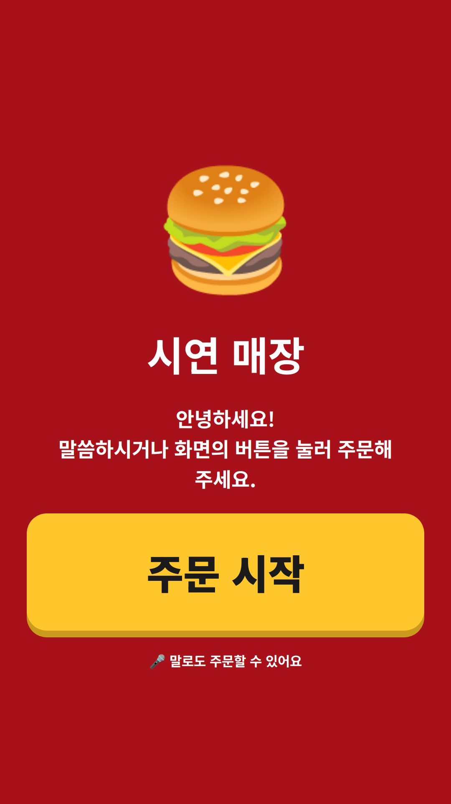 | 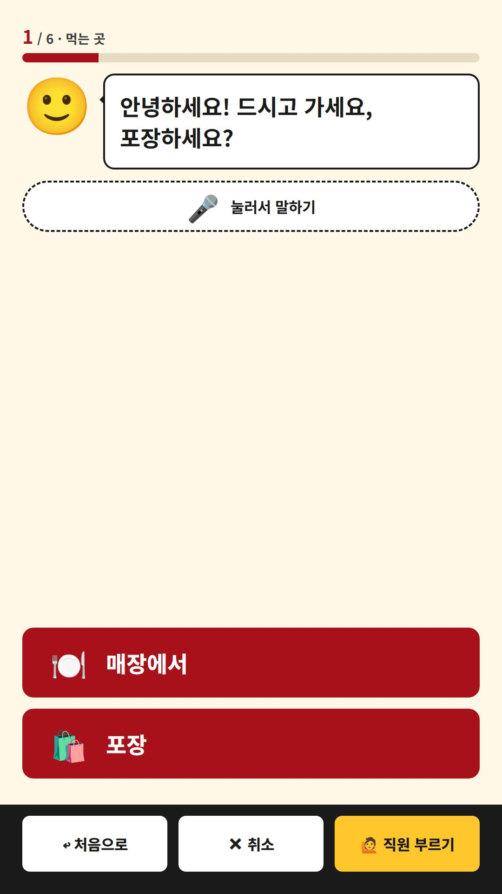 |

---

## 2단계. 주문 화면 만들기 (버튼만으로)

**한 일**
- 버튼을 누르면 **버튼 글자를 그대로 서버에 보내요** (`POST /chat`). 서버가 다음 말과 버튼을 알려 줘요.
- 추천 메뉴는 큰 그림 + 큰 가격 카드로 보여 줘요: [screens/MenuScreen.jsx](../src/screens/MenuScreen.jsx)
- 세트·음료·사이즈를 한 번에 하나씩 물어요: [screens/OptionScreen.jsx](../src/screens/OptionScreen.jsx)
- **음료가 5개라서 2쪽으로 나눴어요.** 1쪽: 음료 3개 + [다른 음료 보기], 2쪽: 음료 2개 + [앞으로] ([lib/paginate.js](../src/lib/paginate.js))
- [메뉴판 보기]로 말 없이 직접 고를 수도 있어요 (한 쪽에 4개씩): [screens/MenuBrowser.jsx](../src/screens/MenuBrowser.jsx)
- 주문 확인 화면에서 [빼기] [하나 더]로 수량을 바꿔요: [screens/ConfirmScreen.jsx](../src/screens/ConfirmScreen.jsx)

**결과**
- ✅ 버튼만 눌러서 "빅맥 세트(라지, 후렌치 후라이, 코카콜라 제로)"를 담았어요.
- ✅ [하나 더] → 16,000원, [빼기] → 8,000원. 금액은 서버가 계산해요.
- ✅ 오렌지 주스 버튼에 "+700원"이 보여요.

| 메뉴 고르기 | 세트로? | 음료 1쪽 | 음료 2쪽 |
|---|---|---|---|
| 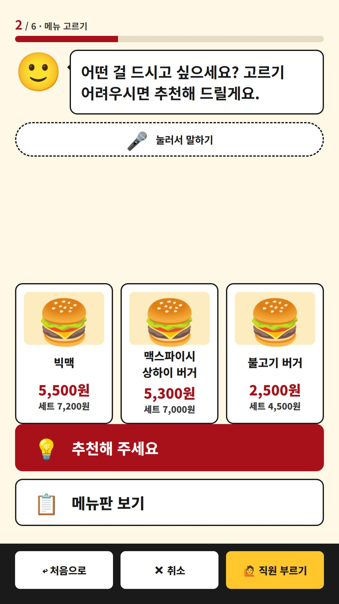 | 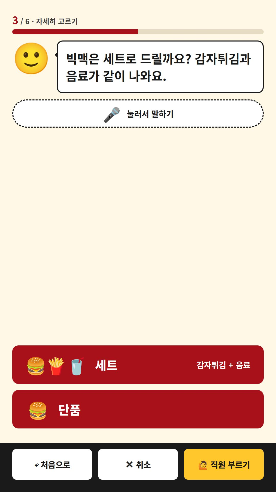 | 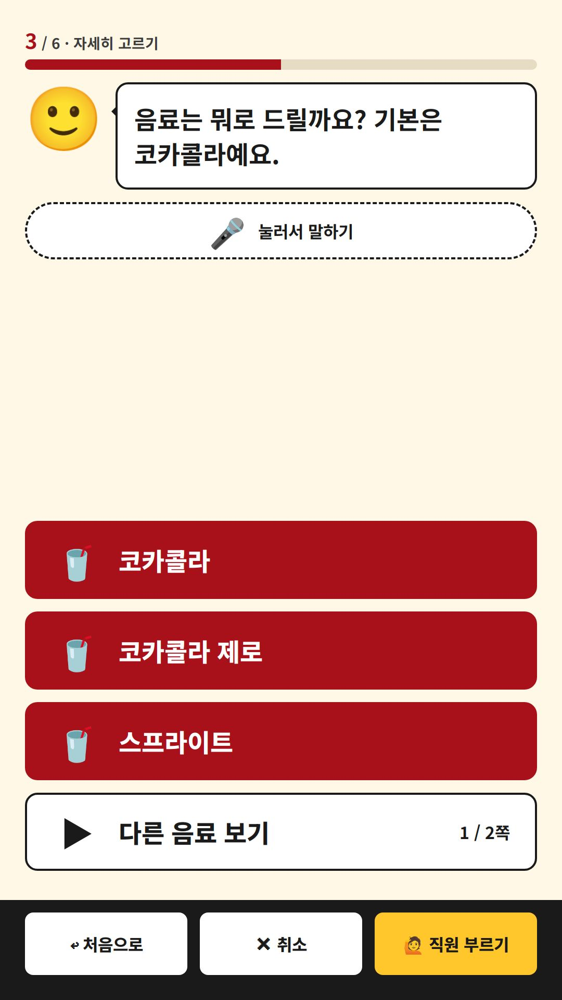 | 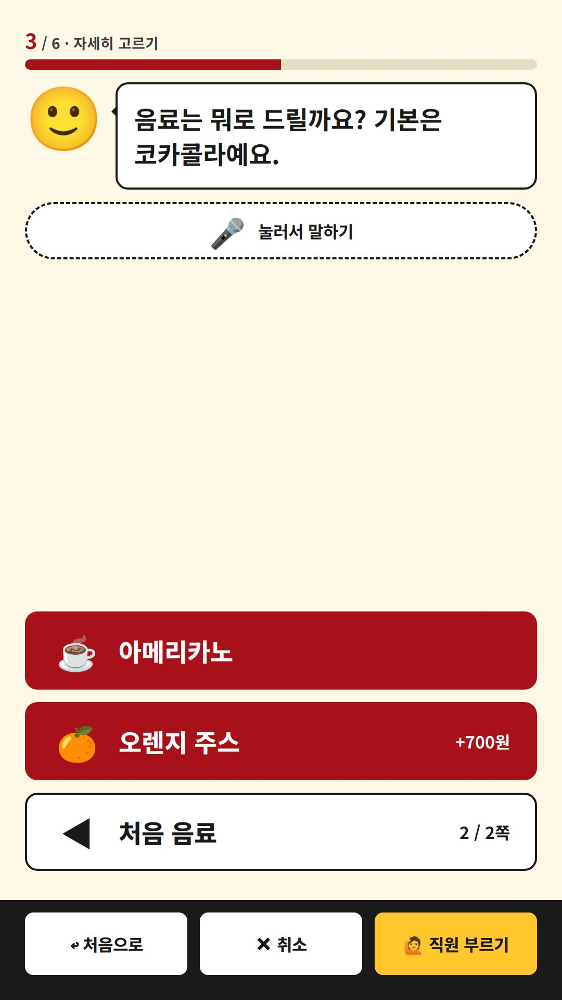 |

| 사이즈 | 주문 확인 | 메뉴판 보기 |
|---|---|---|
| 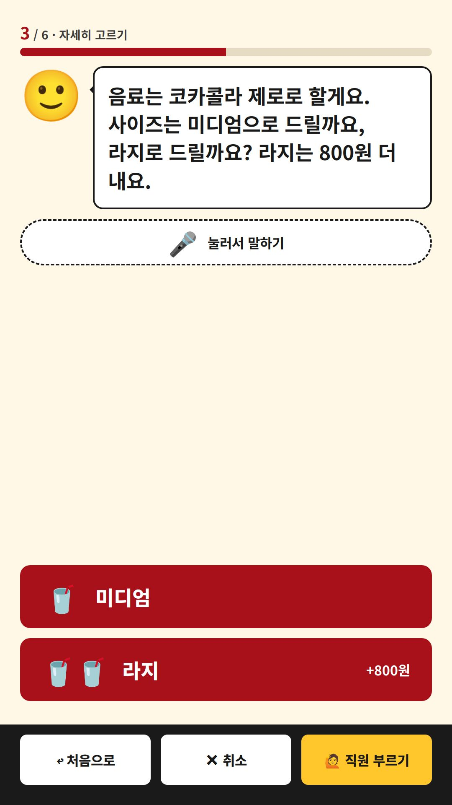 | 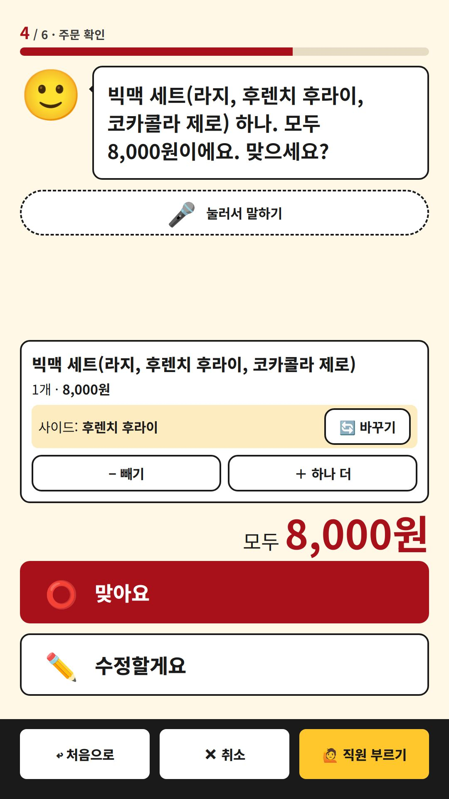 | 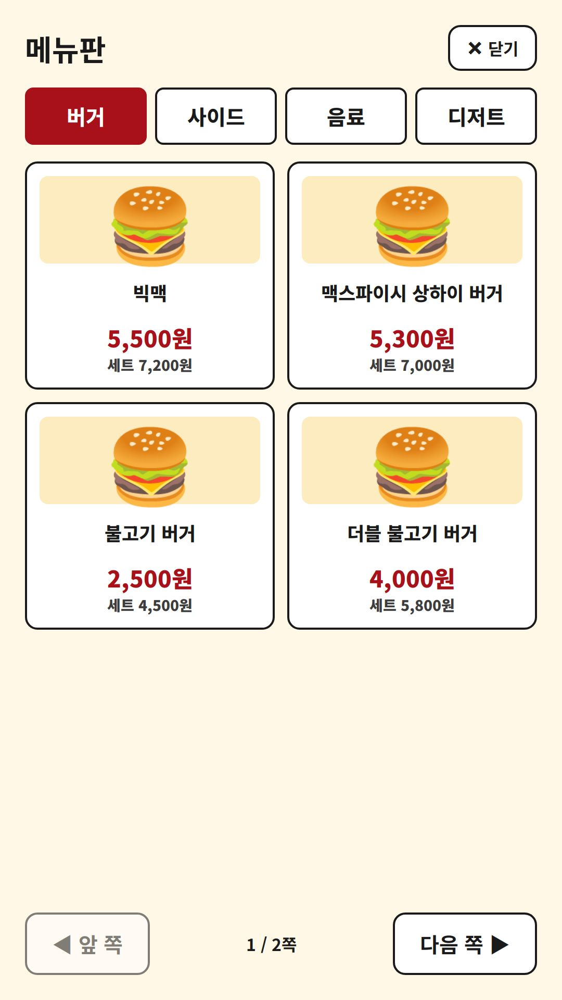 |

---

## 3단계. 쿠폰·결제·주문번호

**한 일**
- 쿠폰 화면에서 **바코드 스캐너 입력**을 받아요. 스캐너는 키보드처럼 글자를 아주 빨리 치고 Enter를 눌러서, 빠르게 들어온 글자만 바코드로 읽어요 ([lib/barcode.js](../src/lib/barcode.js)).
- 스캐너가 없을 때를 위해 **연습용 바코드 입력칸**도 뒀어요: [screens/CouponScreen.jsx](../src/screens/CouponScreen.jsx)
- 결제는 모의 결제예요. [카드 결제]를 누르면 결제 API를 직접 부르고, 카드 기계 대신 **연습용 [결제 성공] [결제 실패]** 버튼으로 결과를 정해요: [screens/PaymentScreen.jsx](../src/screens/PaymentScreen.jsx)
- 같은 결제가 두 번 되지 않게 결제마다 고유 번호(`Idempotency-Key`)를 붙였어요.
- 결제가 되면 주문번호를 아주 크게 보여 주고, 10초 뒤 처음 화면으로 돌아가요: [screens/CompleteScreen.jsx](../src/screens/CompleteScreen.jsx)

**결과**
- ✅ 없는 바코드 → "쿠폰을 읽지 못했어요. 화면 밝기를 높이고 다시 대 주세요."
- ✅ TEST0004 → "기간이 끝난 쿠폰이에요. 쿠폰 없이 결제할까요?"
- ✅ TEST0001 → 8,000원에서 1,000원 할인, **7,000원**
- ✅ [결제 실패] → "결제가 안 됐어요. 다시 해 볼까요?" → [다시 결제할게요] → [결제 성공] → **주문번호 1번**

| 쿠폰 있어요? | 바코드 대기 | 못 읽음 | 기간 끝남 |
|---|---|---|---|
| 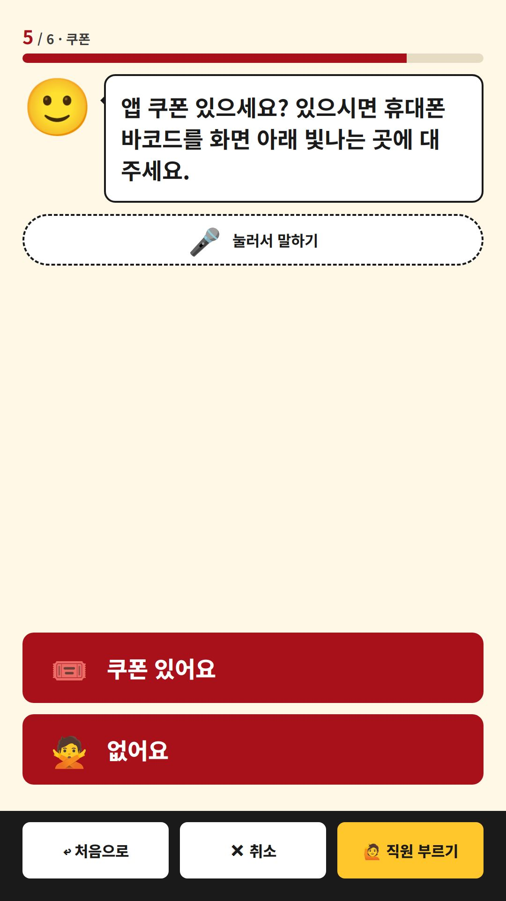 | 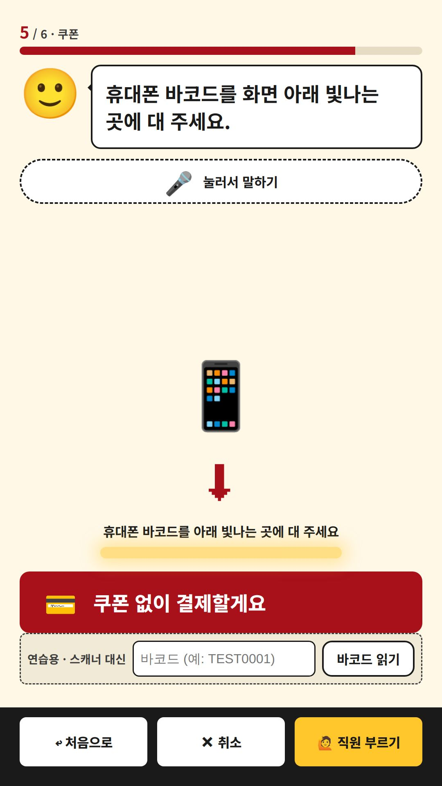 | 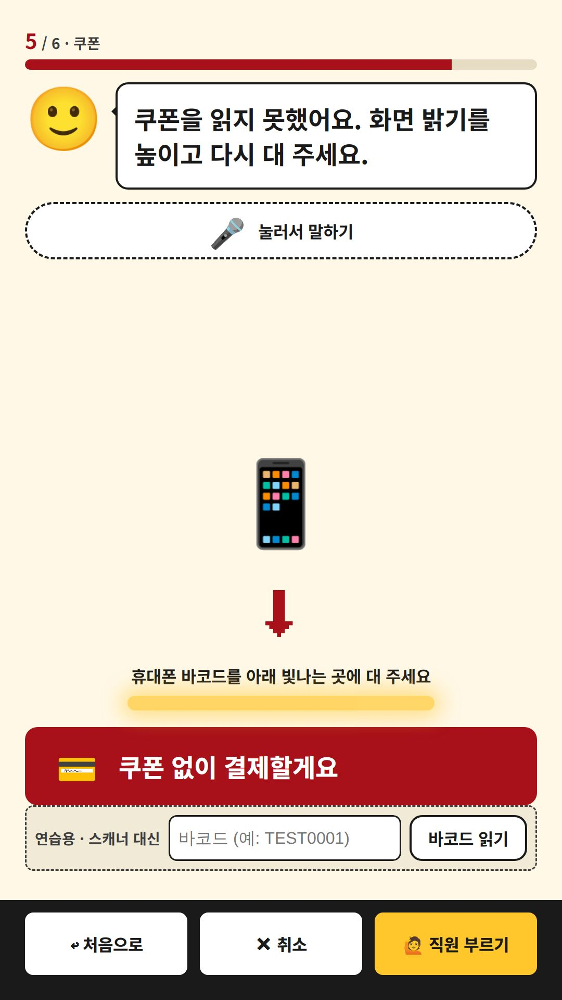 | 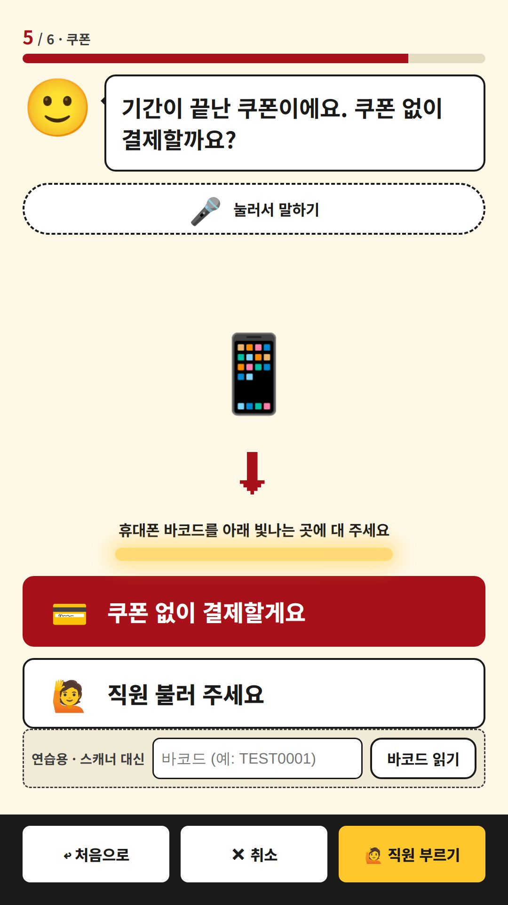 |

| 할인 적용 | 카드 꽂기 | 결제 중 | 결제 실패 | 주문 완료 |
|---|---|---|---|---|
| 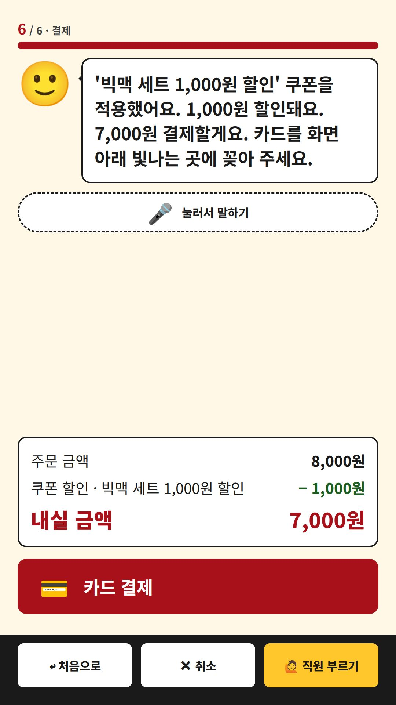 | 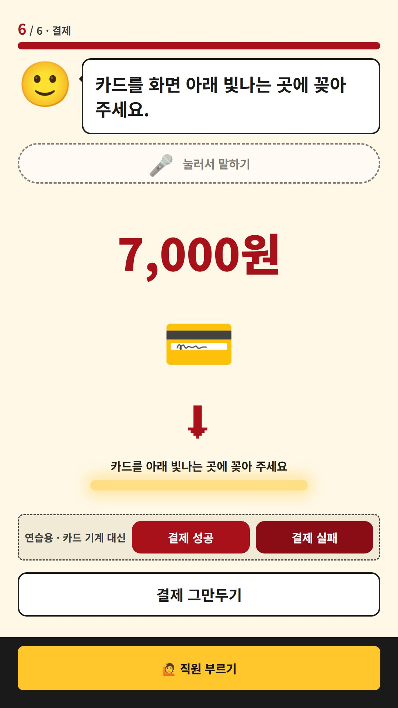 | 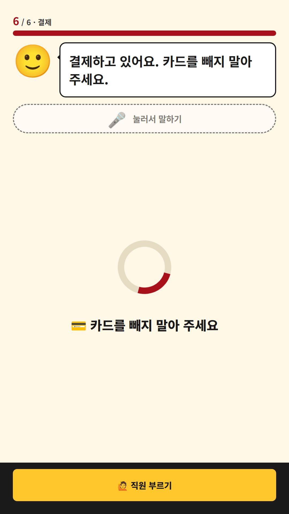 | 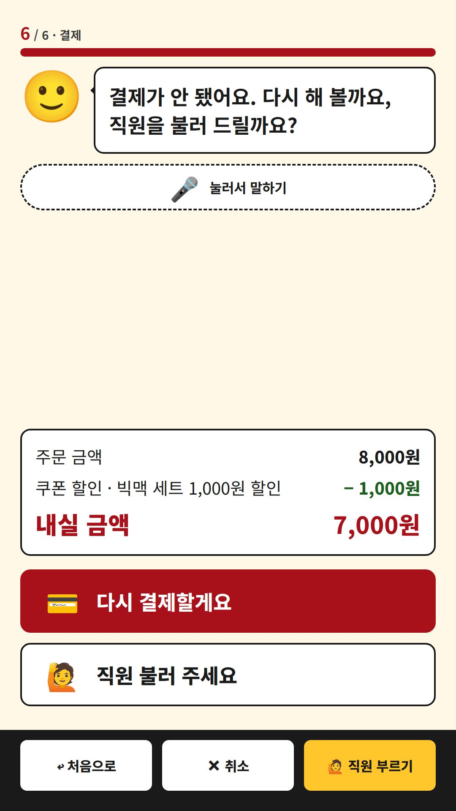 | 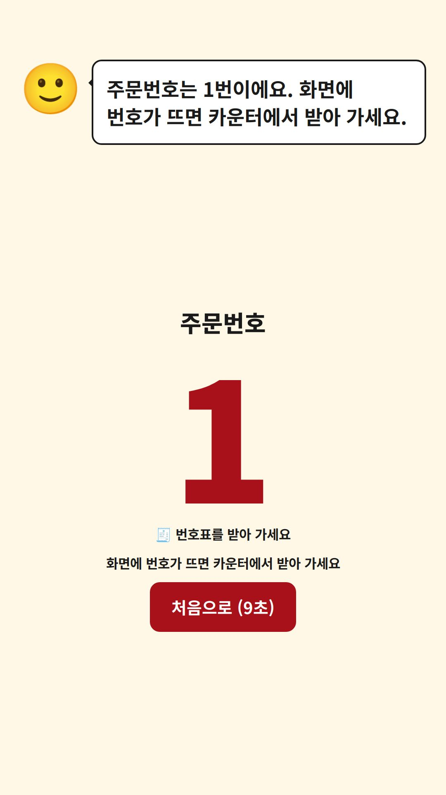 |

---

## 4단계. 곤란한 상황 대비

**한 일**
- **무응답 타이머** ([hooks/useIdleTimer.js](../src/hooks/useIdleTimer.js)): 15초 동안 아무것도 안 하면 "도움이 필요하세요?", 15초 더 지나면 서버에 `DELETE ?reason=timeout`을 보내고 처음 화면으로 가요.
  결제 중, 음성 안내가 나오는 중, 녹음 중에는 타이머가 멈춰요.
- **아래쪽 버튼 3개**: [처음으로]·[취소]는 버튼 글자를 서버에 보내요("취소"는 한 번 더 물어봐요). [직원 부르기]는 직원 호출 API를 불러요.
- **오류가 나면** ([hooks/useKioskSession.js](../src/hooks/useKioskSession.js)):
  - 시간이 지나 끝난 주문(410) → 처음 화면
  - 화면과 서버 단계가 어긋남(409) → 서버 기준으로 화면을 다시 그림
  - 음성 서버 고장(502) → 마이크만 끄고 버튼 주문은 계속
  - 인터넷 끊김 → [다시 해 볼게요] [직원 부르기] 안내

**결과**
- ✅ 15초 → "도움이 필요하세요?" 창이 뜸, 30초 → 처음 화면으로 돌아감
- ✅ [직원 부르기] → "직원을 불렀어요. 잠시만 기다려 주세요."

| 도움이 필요하세요? | 직원 부르기 |
|---|---|
| 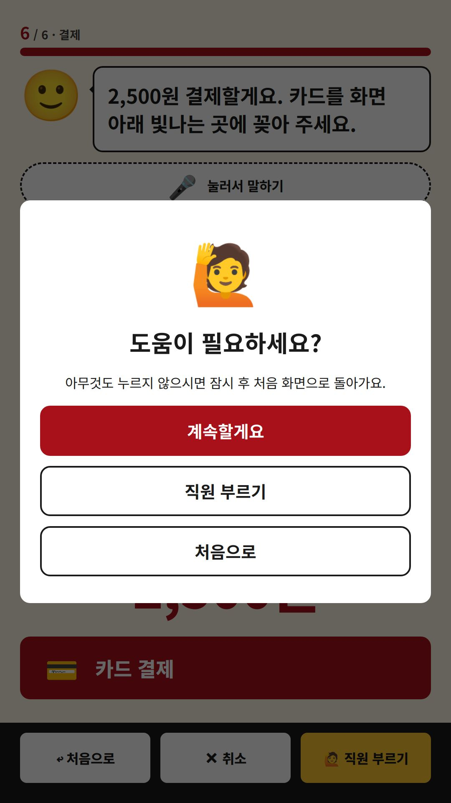 | 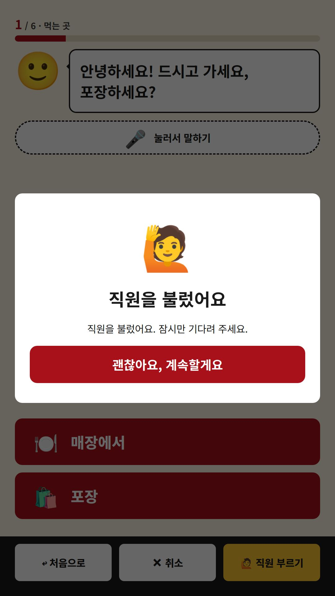 |

---

## 5단계. 말로 주문하기

**한 일**
- 마이크 버튼을 누르면 녹음하고(최대 15초), 다시 누르면 서버 `/voice`로 보내요: [hooks/useVoice.js](../src/hooks/useVoice.js)
- 서버가 알아들은 말을 말풍선 아래에 "이렇게 들었어요: …"로 보여 줘요.
- 새 안내 문장이 오면 **브라우저의 읽어 주기 기능**으로 소리 내어 읽어 줘요 (어르신을 위해 조금 천천히). 음성 안내는 이 방식으로 **확정**됐어요 (PM, 2026-10-19).
- 마이크 상태: 눌러서 말하기 / 듣고 있어요 / 잠시만요 / 음성이 안 돼요

**결과**
- ✅ 소리 없는 녹음을 보내 봤더니 서버가 "다시 한번 말씀해 주세요"라고 대답했어요. 연결은 잘 돼요.
- ⬜ **사람 목소리로 "불고기버거 세트 하나 줘"를 말하는 시험은 아직 못 했어요.** 마이크가 있는 컴퓨터에서 직접 해 봐야 해요.

---

## 6단계. 가게 직원용 화면

**한 일**
- 호출 화면 `http://localhost:3000/pickup`: "준비 중"과 "가져가세요" 번호. 새로 나온 번호는 깜빡이고, [소리 켜기]를 누르면 "1번 고객님, 음식이 나왔어요."라고 읽어 줘요: [store-screens/PickupBoard.jsx](../src/store-screens/PickupBoard.jsx)
- 주방 화면 `http://localhost:3000/kitchen`: 결제된 주문 + [완료] 버튼, 위쪽에 직원 호출 알림 + [처리했어요]: [store-screens/KitchenOrders.jsx](../src/store-screens/KitchenOrders.jsx)
- 두 화면 모두 3초마다 서버에서 새로 읽어요.

**결과**
- ✅ 키오스크에서 결제 → 주방 화면에 "1번" → [완료] → 호출 화면 "가져가세요"에 1번
- ✅ 손님이 [직원 부르기] → 주방 화면에 "키오스크 1번 · 먹는 곳 고르기 · 손님이 불렀어요"

| 주방 화면 | 호출 화면 |
|---|---|
| 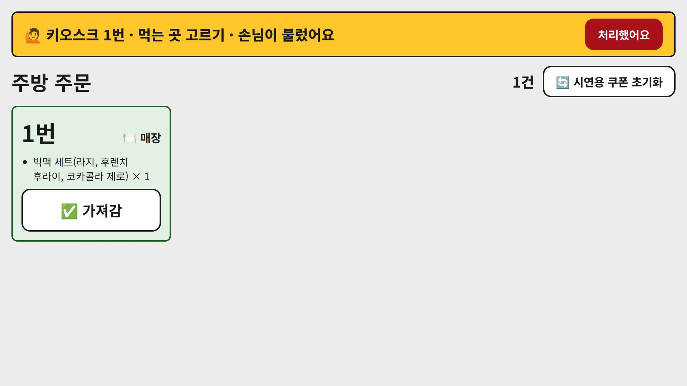 | 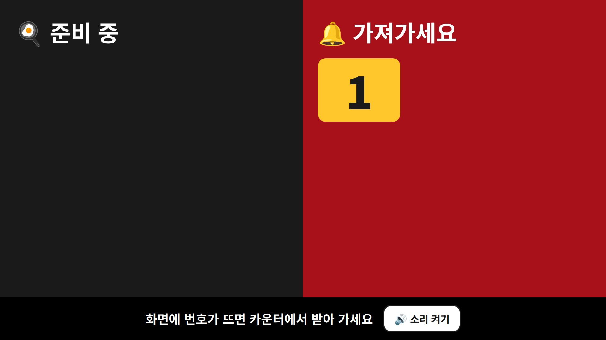 |

---

## 7단계. 마지막 점검

**한 일**
- 작은 부품 시험 14개, 처음부터 끝까지 눌러 보기 27개를 돌렸어요.
- `npm run build`(배포용 파일 만들기)를 했어요.

**결과**
- ✅ 41개 모두 통과, 빌드 성공, 화면 오류(JS 에러) 0개
- ✅ 버튼 높이 120px 이상, 글자와 배경 대비 7:1 이상 색 사용
- ✅ 서버가 준 선택지는 한 화면에 4개 이하 (5개 이상이면 쪽 나누기)
- ⚠️ 메뉴 화면만 누를 곳이 5개예요 (추천 메뉴 3 + [추천해 주세요] + [메뉴판 보기]). 아래 "남은 것" 참고

---

## 2차: 백엔드 PR #19 반영

> 2026-10-19 · PM 전달: 음성 안내 = 브라우저 음성 확정, 발표 시연 = 로컬 docker compose, 백엔드 요청 = 이슈 #14·#15 → 백엔드 PR #19

**한 일**
| 백엔드 답 (PR #19) | 화면에서 바꾼 것 |
|---|---|
| 응답에 화면 구분 값 `question` 추가 | [lib/screen.js](../src/lib/screen.js)가 `question` 으로 화면을 골라요. 값이 없으면(예전 백엔드) 지금처럼 버튼 글자로 짐작해요 → **PR #19가 합쳐지기 전이든 후든 화면이 안 깨져요** |
| 버튼 정보 `choice_items` (가격·menu_id·사진 / 추가 금액) | 메뉴 카드 가격·사진, "+700원" 같은 추가 금액을 서버 값으로 보여 줘요. 없으면 메뉴 목록에서 찾아요 |
| 확인 화면 사이드 바꾸기 (이슈 #13) | 세트마다 `사이드: 후렌치 후라이 [🔄 바꾸기]` → 후렌치 후라이 / 맥너겟 4조각(+500원) / 치즈스틱 2조각(+500원) ([ConfirmScreen.jsx](../src/screens/ConfirmScreen.jsx)) |
| 결제 단계 3분 정리, 쿠폰 묶임 해결 (이슈 #14) | 화면도 **결제 화면(카드 넣기 전)** 에서 무응답 30초면 처음 화면으로 가고 서버에 `timeout` 을 알려 주문·쿠폰을 풀어요. 카드를 넣은 뒤(결제 중)에는 지금처럼 멈춰요 |
| 시연용 `POST /api/demo/reset-coupons` | 주방 화면 위쪽에 **[🔄 시연용 쿠폰 초기화]** 버튼. 자동 테스트도 시작할 때 쿠폰을 초기화해요 |
| 주문 완료 후 10초, `DELETE` 불필요 | 지금 방식 그대로 (바꿀 것 없음) |

기획 결정(PR #11)에 맞춰 음료 2쪽의 돌아가기 버튼 글자를 **[◀ 처음 음료]** 로 바꿨어요.

**결과**
- ✅ 작은 부품 시험 23개 통과 (`question` 화면 고르기, 사이드 찾기 등 9개 추가)
- ✅ 화면 전체 자동 테스트 33개를 **두 번** 통과: 지금 main 백엔드(PR #19 전)에서 한 번, PR #19 백엔드에서 한 번
- ✅ 사이드를 맥너겟으로 바꾸면 8,000원 → 8,500원, 다시 후렌치 후라이로 바꾸면 8,000원

| 사이드 표시 | 사이드 고르기 |
|---|---|
|  | 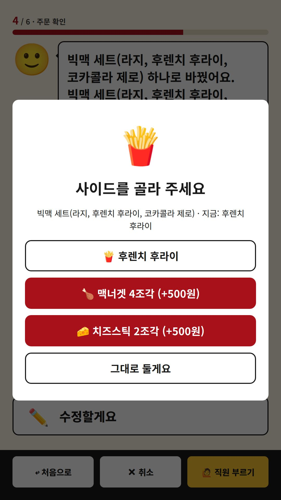 |

## 아직 남은 것 · 알아 둘 것

| 내용 | 이유 / 다음에 할 일 |
|---|---|
| 메뉴 사진 대신 🍔🍟🥤🍦 그림 글자 | 서버 메뉴에 사진 주소(`image_url`)가 아직 없어요. 사진이 생기면 [MenuCard.jsx](../src/components/MenuCard.jsx)만 바꾸면 돼요 |
| ~~화면 구분을 버튼 글자로 짐작~~ | ✅ 해결: 백엔드 PR #19의 `question` 값으로 화면을 골라요 (아래 "2차") |
| 사람 목소리 시험 | 마이크 있는 컴퓨터에서 직접 해 보기 |
| 진행 표시·"이렇게 들었어요" 글씨 28px | 기획 규칙(본문 32px)보다 작은 보조 글씨예요. 기획 확인이 필요해요 |
| 메뉴 화면에 누를 곳 5개 | [메뉴판 보기]를 따로 더해서 규칙(3~4개)보다 1개 많아요. [메뉴판 보기]를 작게 하거나 [추천해 주세요]와 합칠지 기획과 정하기 |
| 주방 "조리 중" 상태 | P1(시간 되면)이라 [완료]만 만들었어요 |
| ~~결제 화면에서 손님이 떠난 주문~~ | ✅ 해결: 화면은 30초 무응답이면 정리, 서버는 3분 정리 + 시연용 쿠폰 초기화 (아래 "2차") |

## 내 컴퓨터에서 직접 보는 방법

1. Docker Desktop을 켜요.
2. 저장소 맨 위 폴더에서 `docker compose up --build`
3. 브라우저에서 열기
   - 손님 화면: http://localhost:3000
   - 호출 화면: http://localhost:3000/pickup
   - 주방 화면: http://localhost:3000/kitchen
4. 연습용 쿠폰: `TEST0001`(빅맥 세트 1,000원) `TEST0002`(후라이 무료, 5,000원 이상) `TEST0003`(10%) `TEST0004`(기간 끝남) `TEST0005`(이미 사용)
